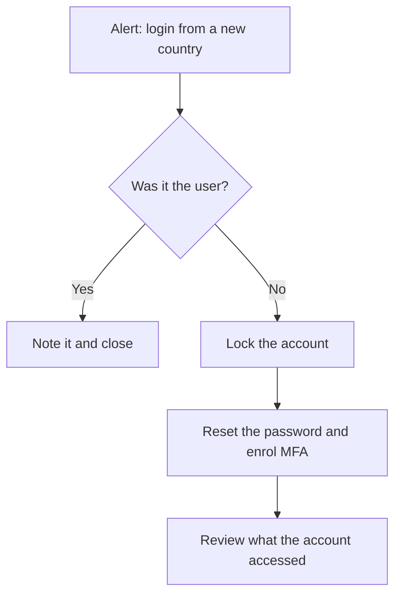
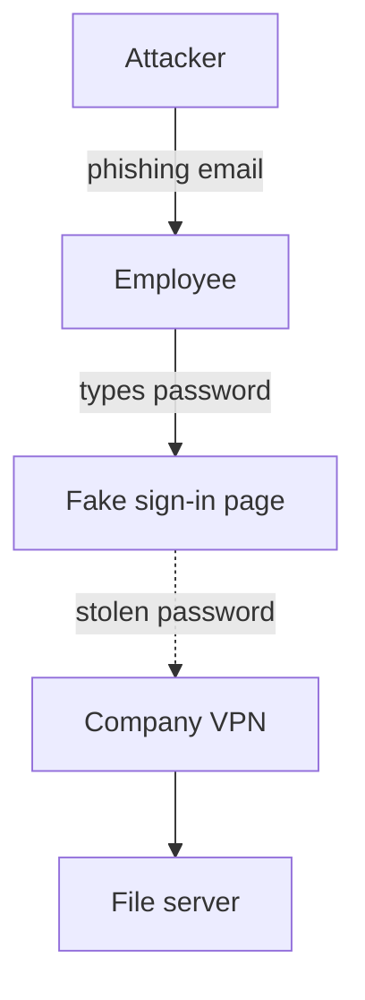
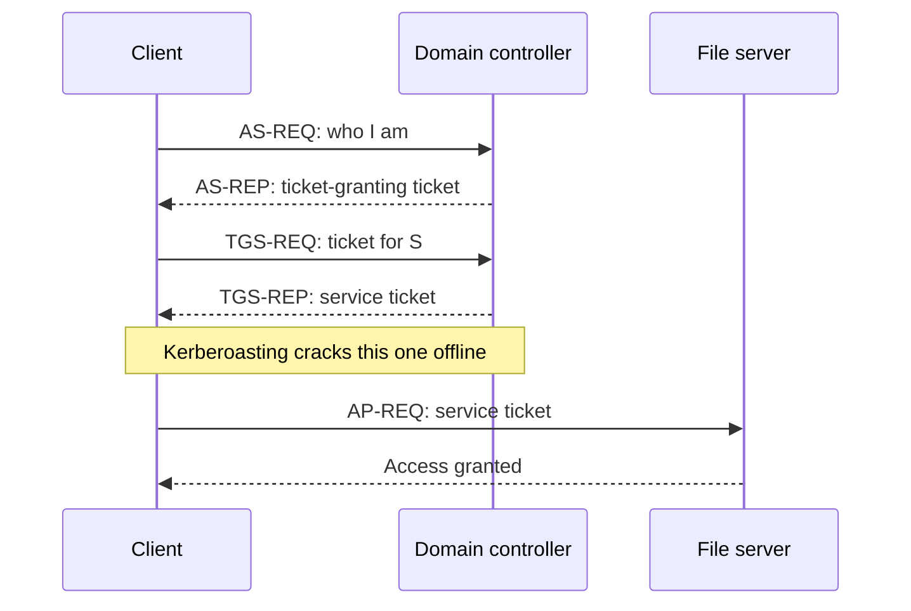
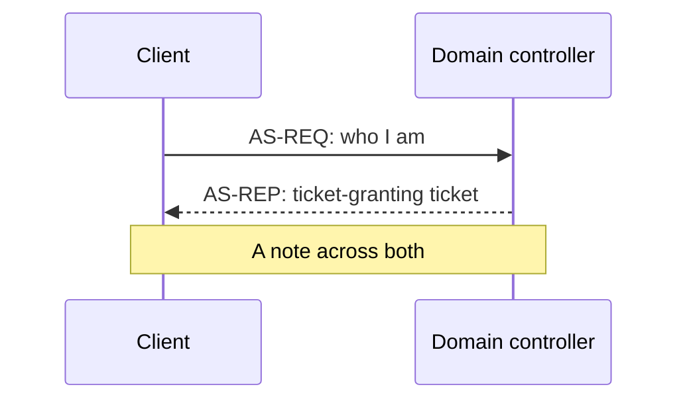
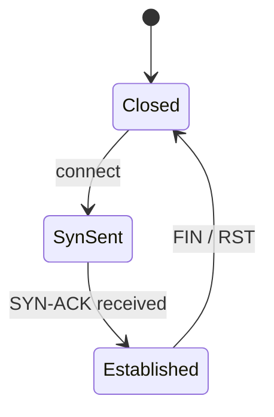

A `mermaid` block turns a few lines of text into a diagram, drawn in the site's colours (in whichever colour theme the learner picked). It suits flows and sequences: how an attack unfolds, a decision to make, the messages in a protocol. The text stays in the lesson, so it can be changed in the admin editor like any other text.

For a network layout (zones, hosts and how they connect), draw it in draw.io instead: see [Network diagrams](../02-content/diagrams.md).

## Flowcharts

`flowchart TD` runs top to bottom (`LR` runs left to right). Each line connects two boxes: an id, then the label in brackets. `[…]` is a box, `{…}` a decision, and text between `-->|` and `|` labels the arrow.



````md

````

## Highlighting a box

Add `:::highlight` to a box to outline it in the accent colour (the one the lesson is about), or `:::attack` to outline it in red (an attacker, or an attack step). Dotted arrows are `-.->`.



````md

````

## Sequence diagrams

A `sequenceDiagram` shows messages between systems, in order. `->>` is a request, `-->>` a reply, and `Note over` adds a comment.



````md

````

## Other kinds

Mermaid can also draw state diagrams (`stateDiagram-v2`), timelines of dates (`timeline`), pie charts (`pie`), mind maps (`mindmap`) and more; see [Mermaid's documentation](https://mermaid.js.org/intro/). For events in order, the site's own [timelines](timelines.md) usually read better in a lesson.



````md

````

## Good to know

- **Describe the diagram for screen readers** with `accTitle` and `accDescr` lines at the top, and say the important part in the lesson text too:

  ````md
  ```mermaid
  flowchart LR
      accTitle: Phishing to VPN access
      accDescr: A phishing email leads to a stolen password, which opens the company VPN.
      attacker[Attacker] --> user[Employee]
  ```
  ````

- **A mistake stops the site from publishing**, like a broken quiz: the pipeline names the page and the line. Try a diagram first in the [Mermaid live editor](https://mermaid.live) if you're unsure.
- Keep labels short, and use documentation addresses (`192.0.2.x`) as everywhere else.
- Diagrams are drawn in the browser, so they don't appear in site search. Until one is drawn, an empty panel of about its size holds its place, so the text below doesn't jump.
